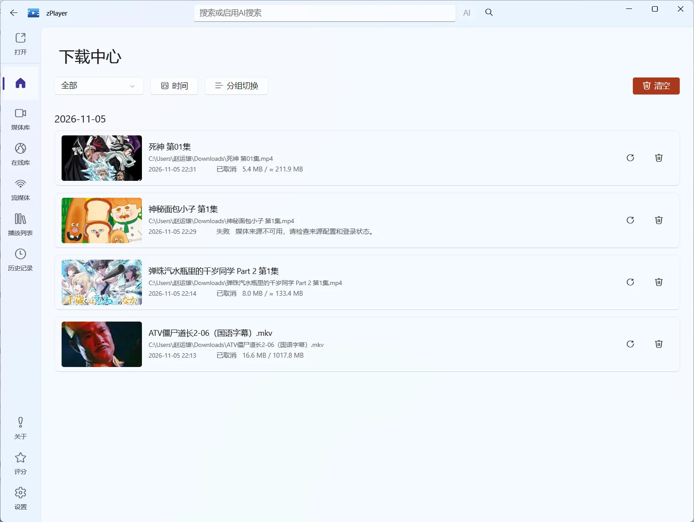

# 下载中心：把下载任务集中到一处

从首页、媒体库或在线库发起的下载，都会统一进入下载中心，不再散落在各个页面。主界面顶部的下载入口会显示正在进行的任务数，点开就能看到全部任务、当前进度和失败原因。

图：下载中心按日期分组列出任务，每条都能看到保存位置、状态和已下载大小；右侧可以直接重试或移除。

## 从哪里发起下载

| 发起位置 | 典型用途 |
| --- | --- |
| 首页 | 在媒体卡片或继续观看条目上直接保存当前内容 |
| 媒体库 | 下载选中的文件或整个文件夹，保留原有目录结构 |
| 在线库 | 把正在播放的在线剧集或电影保存到本地 |

在线媒体的播放地址通常是分片流，下载完成后统一保存为 `.mp4`。本地文件和文件服务里的媒体会保留原扩展名。

## 任务列表里能做什么

| 操作 | 说明 |
| --- | --- |
| 取消 | 停止正在排队或下载中的任务 |
| 从头重试 | 重新开始已失败或已取消的任务；目标文件已经存在时会先询问是否覆盖 |
| 移除记录 | 从列表中删掉已经结束的任务，不会删除已经下载好的文件 |
| 清空已结束 | 一次性移除所有已完成、已取消、已失败和已中断的记录 |

同一时间最多并行下载两个文件，其余任务排队等待。目标文件已经在下载时，重复发起不会新增任务，软件会提示已经排队。

## 状态和进度

每个任务会显示来源名称（例如某个在线站点或某个文件服务）、保存位置、创建时间、完成时间，以及当前状态：

| 状态 | 含义 |
| --- | --- |
| 排队中 | 已加入队列，等待空闲的下载位 |
| 下载中 | 正在接收数据，显示已下载大小和实时速度 |
| 合并中、写入中 | 分片下载完成后合并并写入最终文件 |
| 已完成 | 文件已经写入目标位置 |
| 失败 | 显示具体错误，可以按需重试 |
| 已取消 | 被你手动取消 |
| 已中断 | 软件退出时任务还没有结束；重新打开后会保留记录 |

下载记录保存在本地，重启软件后仍然可以看到历史任务和失败原因。

## 保存位置和覆盖

下载前可以选择保存目录。目标文件已经存在时，软件会先询问是否覆盖，确认后才会写入。

在线剧集按集生成文件名，重复下载同一集会命中同一目标路径。批量下载文件夹时，软件会按原目录结构创建子目录，重名时自动追加序号，不会直接覆盖同名文件。

## 遇到问题怎么办

| 现象 | 先检查什么 |
| --- | --- |
| 任务一直排队 | 是否已有两个任务在下载；等前一个结束后会自动开始 |
| 进度长时间不动 | 在线来源是否仍然可用；可以先取消再从头重试 |
| 提示保存失败 | 目标磁盘空间、目录权限和目标路径是否可写 |
| 重试时提示要覆盖 | 目标文件已经存在；确认不需要保留旧文件再继续 |
| 重启后出现“已中断” | 上次退出时任务还没完成，可以重试或移除 |
| 下载中心一直显示存储错误 | 下载记录文件无法读取或写入；错误会持续显示，避免覆盖原记录 |

下载只保存到本机，不会上传到云端，也不会自动把文件加入媒体库。想让下载下来的内容出现在首页，还需要把保存目录添加为[文件服务](/docs/media/file-services)来源。

