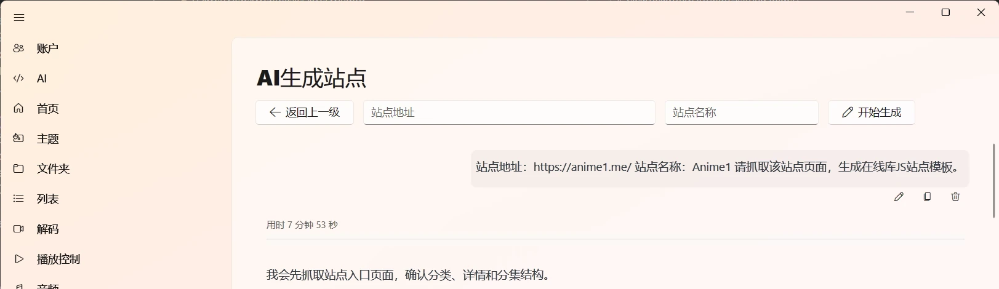
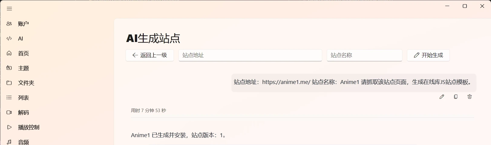

# AI 生成与修复 JS 站点：把写脚本这一步交给对话

在线库的 JS 爬虫站点原本要自己看页面、找接口、写脚本。现在可以让 AI 先做一版：你给站点地址和名称，它去抓页面、写草稿、跑验证，通过后自动装进在线库。站点改版失效时，也能让它先查问题再修。

这个功能适合你手里有明确站点、但不想从零写 JS 的情况。它不提供站点地址，也不保证任何站点都能生成；站点结构、登录限制和接口变化都会影响结果。

## 先准备模型

入口是“设置 → 在线库 → JS 爬虫站点”。页面顶部的“AI生成站点”按钮只有在配置了支持工具调用的默认对话模型后才能正常使用。模型不支持工具调用时，页面会提示你到 AI 设置里换一个模型。

模型怎么添加、API 地址和 Key 怎么填，见[AI 模型与内容理解](/docs/settings/ai)。生成过程会消耗模型额度，站点页面越复杂，需要抓取和分析的内容越多。

## 生成一个站点

1. 在 JS 爬虫站点页面点“AI生成站点”。
2. 填写站点地址。地址要以 `http://` 或 `https://` 开头。
3. 填写站点名称。名称不能为空，有长度限制，也不能和保留名冲突；已经存在同名站点或草稿时，软件会问你要不要覆盖。
4. 进入页面后，下方就是聊天窗口。之前生成过的对话可以在这里查看和切换，不需要重新开一个。
5. 点“开始生成”，AI 会抓取站点页面、阅读结构、写 JS 草稿，然后调用验证器检查。

图：填写站点地址和名称后，AI 会在下方对话里开始分析页面并生成草稿。

生成过程中会显示抓取了哪些页面、写了哪些草稿、验证到了哪一步。你可以继续在输入框里补充信息，比如“分类页在 /list/2.html”“播放地址要从 m3u8 里取”。模型不理解的细节，直接说页面路径或你看到的现象，比反复让它猜更快。

验证通过后，草稿会自动安装到 JS 站点目录，页面会给出站点版本和安装结果。回到站点列表，勾选启用，再到在线库实际浏览、搜索和播放一次。

图：生成完成后会显示站点版本和安装结果，仍然要到在线库实际播放验收。

## 验证检查了什么

验证器会按“站点信息 → 分类 → 列表 → 分集 → 播放地址”的顺序跑一遍。它能发现站点打不开、列表为空、看不到集数、播放地址取不到这类明显问题。

默认只检查第一条能跑通的 HTTP 媒体样本，不会把所有线路、所有剧集都试一遍。HTTP 样本能读到，也不等于播放器一定解码成功。生成完成后，仍然要自己挑几集、换几条线路实际播一下。站点显示“全 12 集”，也不代表每条线路都有 12 集。

如果开启了审核模式，验证通过后安装前会请求你确认。你可以先看报告，再决定装不装。审核模式的说明在[AI 对话与 Agent](/docs/settings/ai-chat)。

## 生成后怎么验收

- 在站点列表点“检测”，确认站点信息、分类和列表能回来。
- 到在线库选这个站点，打开一个分类，确认分页和搜索正常。
- 打开一部有分集的剧，确认线路名、集数和详情能对应。
- 实际播放两三条线路，不要只看验证报告。
- 换一部电影和一集电视剧各试一次，确认不是只对样本有效。

发现问题时，不一定要从头生成。列表里的“AI修复”更适合处理已经装好的站点。

## 用 AI 修复失效站点

JS 站点列表每一行都有扳手按钮“AI修复”。点开后，软件会先自动检测这个站点，再根据失败的位置给出修复方向：

| 检测到的表现 | 常见原因 |
| --- | --- |
| 站点打不开或一直加载 | 入口地址、host 或站点信息变了 |
| 能打开首页但列表为空 | 分类、搜索、分页接口或页面结构变了 |
| 能打开影片但看不到集数 | 详情页、选集容器或线路字段变了 |
| 能看到集数但播放失败或一直转圈 | 播放接口、签名、Referer、Range 或线路失效 |

页面会把这些方向列成可选项，第一项通常是“按检测结果修复”。你也可以不选预设，直接在聊天里描述问题，比如“第 2 条线路播放时 403，换 Referer 也不行”。修复会先把当前站点复制成草稿，改完再验证，不会直接覆盖正在用的版本。验证通过后仍然按审核模式安装。

修复同样受验证范围限制。报告说通过，只代表这次检查的样本和线路能走通；其他线路和剧集还要自己抽查。

## 站点参数配置

有些 JS 模板不是写死所有信息的，它会声明几个外部参数，比如接口域名、账号、Cookie、清晰度偏好或开关。站点列表里的齿轮按钮就是“站点参数配置”。

参数支持文本、密码、布尔开关和下拉选项。模板可以要求某一项必填，也可以给默认值、说明和输入提示。密码字段可以显示、隐藏、粘贴和清空；保存后参数会记在这个站点名下。缺少必填项时，站点状态会显示“待配置”，在线库不会把它当成可用站点。

参数以明文保存在本机，不随脚本文件分享。不要把账号密码写进脚本正文，也不要在截图、日志或反馈里带出参数内容。站点模板没有声明参数时，齿轮按钮会提示“此站点未声明可配置参数”。

如果参数声明写错了，页面会提示声明无效。常见原因是 `parameters` 不是严格 JSON 数组、字段键重复、类型不支持，或者下拉选项的值重复。

## 安全和限制

生成出来的是会发网络请求、解析外部页面的 JS 代码。只对自己信任、有权访问的站点生成和安装，不要拿来源不明的站点做实验。

AI 会写错代码，也会把页面结构理解错。验证器能挡掉一部分明显问题，但挡不住所有情况。站点有登录、验证码、地区限制或频繁改版时，生成成功率会明显下降。遇到这类站点，手动写或找现成模板通常更稳。

生成和修复都依赖模型服务。模型额度用完、接口超时或服务商限制，都会让过程停在中途。已经写好的草稿不会因为对话中断而消失，可以重新打开对话继续。

## 常见问题

| 现象 | 先检查什么 | 处理 |
| --- | --- | --- |
| 点“AI生成站点”没反应 | 是否配置了默认对话模型、模型是否支持工具调用 | 到 AI 设置里换一个支持工具调用的模型 |
| 名称不能保存 | 是否为空、太长、用了保留名，或和已有站点重名 | 换一个更简短、唯一的名称 |
| 一直抓不到页面 | 地址是否可访问、是否需要登录、是否有地区限制 | 先在浏览器打开确认；需要登录的站点不适合直接生成 |
| 验证通过但播放失败 | 只验证了 HTTP 样本，播放器解码或线路仍有问题 | 换线路实际播放；仍失败时用 AI 修复并描述具体错误 |
| 修复后还不如原来 | 草稿可能只改了局部，验证样本也不完整 | 保留原站点备份；必要时停用新版本，回到可用版本 |
| 站点显示“待配置” | 模板声明了必填参数 | 点齿轮填写参数并保存 |

生成站点只是把“从零写脚本”变成“先让 AI 做一版，再自己验收”。真正决定能不能长期用的，还是站点本身是否稳定，以及你有没有实际播放验证过。
