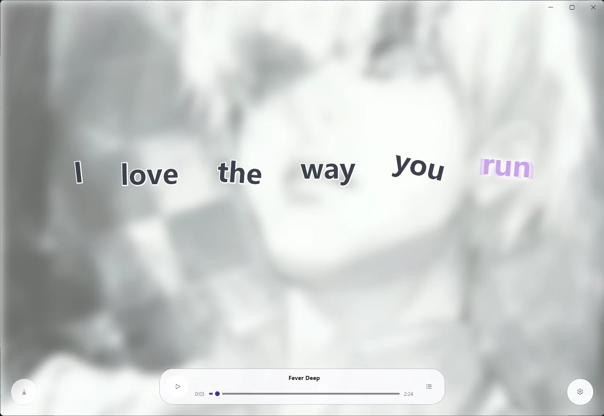

# 音乐播放器：把歌单、封面和歌词放在一起

zPlayer 播放音乐时，会打开独立的音乐播放器，而不是把音频硬塞进视频播放器。它更像一个专门为歌曲准备的小型播放空间：背景使用专辑封面，底部负责播放控制，歌词负责跟着音乐变化。

如果只是偶尔打开一个本地音频文件，可以使用“打开 → 文件”；在 Windows 11 中把对应格式的默认应用设为 zPlayer 后也可直接双击。如果有一批音乐，或者想使用网易云音乐、QQ 音乐中的歌单，建议先通过[文件服务](/docs/media/file-services)添加来源。这样歌单、播放记录和音乐栏目才能长期保留下来。

## 在线音乐：先登录来源，再从歌单开始

在线音乐主要通过网易云音乐和 QQ 音乐连接使用。它们属于“在线音乐”来源，不走电影、电视剧的 TMDB 刮削流程，内容类型会固定为“音乐”，不能改成电影或电视剧。

第一次使用可以按这条路径操作：

1. 进入“媒体库 → 连接管理”，选择“在线音乐”分类。
2. 选择网易云音乐或 QQ 音乐，按页面提示使用手机扫码登录。
3. 保存连接，回到首页等待在线音乐栏目自动刷新。
4. 打开歌单，选择一首歌曲；歌曲会交给独立音乐播放器播放。

在线音乐来源和本地音乐的区别在于：在线歌曲、封面、歌词和播放地址由服务返回，登录状态失效或来源暂时不可用时，首页可能暂时无法加载对应内容。重新登录或刷新来源即可，不需要把它当成 TMDB 刮削错误处理。

## 首页上的在线音乐栏目

在线音乐登录成功后，首页可以把来源中的歌单和歌曲组织成栏目。栏目中的卡片通常会显示封面、歌曲名称、歌手和播放状态；点击歌单可以继续浏览，点击歌曲则直接进入播放。

它和首页的电影、电视剧栏目是两条不同的内容链路：电影和电视剧关注作品、季集和片源，音乐关注歌单、歌曲、歌手、专辑和歌词。在线音乐不会因为播放过一次就变成 TMDB 媒体，也不会自动加入电影或电视剧的刮削库。

## 两种播放界面：动画 MV 和字幕 MV

音乐播放器现在有两套界面，入口都在“设置 → 播放器 → 播放控制 → 音乐播放界面”。改完后，下次打开音乐窗口才会换，当前已经开着的窗口不会马上变。

| 界面 | 适合什么情况 |
| --- | --- |
| 动画 MV | 想听歌时带点画面和节奏感，歌词、场景、镜头会一起动 |
| 字幕 MV | 只想安静看歌词，或者电脑不适合跑动画渲染 |

默认使用动画 MV。WebView2 初始化失败，或者动画渲染进程异常时，软件会自动退回字幕 MV 播放器，歌不会因此停掉。动画窗口里出现错误时也能重试，页面里有诊断入口。

## 动画 MV：歌词、场景和节奏放在一起

动画 MV 是新的音乐动画窗口。画面、歌词、播放条、队列和设置都由动画界面渲染，窗口、音频和出错时的兜底交给主程序。它更适合流行歌、动漫歌曲和带明显节奏的内容。

窗口里的“播放设置”可以调这些选项：

| 选项 | 作用 |
| --- | --- |
| 画质 | 轻量、标准、精细；配置一般的电脑先用轻量 |
| 动效强度 | 控制场景、镜头和文字动画的幅度 |
| 歌词延迟 | 歌词整体提前或延后时微调 |
| 显示歌词 | 关掉后只留画面 |
| 逐字呈现 | 让当前句按字出现 |
| 关键词效果 | 歌词里的关键词做强调 |
| 剧情镜头 | 根据歌曲内容切换场景镜头 |
| 撞击震屏 | 节奏重的段落做轻微震屏 |
| 环境动效 | 天气、光点、粒子之类的背景变化 |
| 节奏联动 | 让画面跟着节拍变化 |
| 歌词随乐 | 歌词排版跟着旋律变化 |
| 播放模式 / 播放速度 | 播完停止、单曲循环、顺序、随机，以及 0.25～2 倍速 |

底部的“播放队列”可以添加下一首、追加到队尾、清空待播、保存队列、上移、下移和删除。队列只影响当前窗口；临时连着听几首，可以直接改队列，以后还想重复用，再把队列保存成播放列表。

在线歌曲仍然有“下载”入口。下载成功时，会尽量把原文歌词保存为同名 `.lrc` 文件，方便下次本地播放。

## 字幕 MV：经典歌词播放器

字幕 MV 就是原来的独立音乐播放器。它用专辑封面做背景，底部放播放控制，歌词按时间轴逐行推进；来源同时提供译文时，译文会显示在原文下面。

它保留这些操作：

- 播放、暂停、上一首和下一首；
- 拖动进度、调整音量和播放速度；
- 播放完停止、单曲循环、顺序播放和随机播放；
- 打开播放列表，添加下一项、追加到队尾、调整顺序、移除或清空待播内容；
- 查看歌曲名、歌手和专辑，并点击对应信息进行复制；
- 在线歌曲显示“保存到本地”入口，下载成功时会尽量保存同名 `.lrc` 歌词。

字幕 MV 的播放列表也只影响当前窗口。临时连着听几首，可以直接改队列；以后还想重复使用，再把队列保存成播放列表。

歌词来源有两种：在线音乐优先读取网易云音乐或 QQ 音乐返回的歌词和译文；本地音乐优先匹配歌曲旁边的同名歌词文件，也可以在歌词设置里手动打开 `.lrc`。歌词没有加载出来时，先看播放器设置面板显示的歌词来源；来源为空时，可以点“打开歌词”自己选文件。歌词整体提前或延后时，用“字幕延迟”左右调，不用先去改歌曲文件。

图：字幕 MV 使用经典歌词播放器，把专辑封面、动态歌词和播放控制放在同一个窗口中。

## 字幕 MV 的 PV 歌词动画

字幕 MV 的设置面板里有 PV 动画标签，可以调整歌词的表现方式。这些选项只影响字幕 MV，不要到动画 MV 的设置里找。

| 选项 | 作用 | 建议 |
| --- | --- | --- |
| 字间距 | 调整歌词字符之间的距离 | 歌词较长或字体较大时，从较小值开始 |
| 强调缩放 | 当前歌词被强调时的放大程度 | 想突出当前句时增加，过大可能影响连续阅读 |
| 光晕强度 | 当前歌词的发光效果 | 深色封面上适当增加即可 |
| 动画安全区域 | 限制歌词动画不要贴近窗口边缘 | 小窗口或歌词较长时适当调大 |
| 波浪动画 | 让歌词按音乐播放器的节奏产生波浪变化 | 喜欢 MV 感觉时开启，追求稳定阅读时关闭 |
| 波浪幅度、周期 | 控制波浪变化的大小和速度 | 先使用中等值，避免文字晃动过强 |

推荐先保持默认值播放一首完整歌曲，再一次只调整一项。PV 动画更适合歌词、音乐视频和演唱会内容；如果只是看普通对白或学习文字，使用普通字幕样式会更清楚。

## 音乐播放器和视频播放器怎么分工

音乐播放器负责歌曲、歌单、封面、歌词和连续播放；视频播放器负责画面、字幕、弹幕、片头片尾和画质处理。两者都能记录播放进度，也都能使用播放列表，但控制界面不会完全相同。

遇到音频轨道、系统输出设备或均衡器问题，查看[音频与均衡器](/docs/player/audio)；想查询默认播放模式和播放器相关设置，查看[播放、解码与画质设置](/docs/settings/playback)。

::: tip 一条最省心的使用习惯
在线音乐先从一个歌单开始测试：确认登录、封面、歌词和播放都正常后，再把其他歌单加入首页。歌词效果不满意时，先确认当前用的是动画 MV 还是字幕 MV，再只调整对应界面里的设置；不要同时改音量、播放速度和系统音频输出，这样更容易找到真正影响体验的选项。
:::
