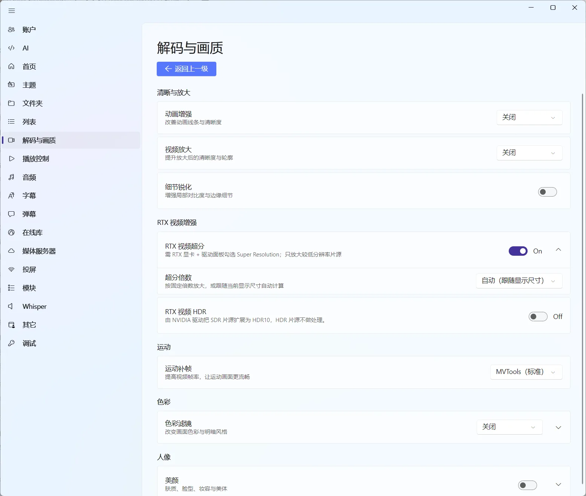

# 画质与滤镜：先稳定，再追求效果

画质选项适合在“视频已经能稳定播放”之后使用。着色器、滤镜和其他实时处理会增加 GPU 或 CPU 负担，画面变漂亮的同时，也可能带来卡顿、发热或音画不同步。

## 播放中可以快速处理的画面问题

在播放器菜单的“视频”分组中，可以按当前片源处理：

- **视频轨道**：多轨视频时选择需要播放的轨道；
- **画面比例**：在默认、16:9、16:10、4:3 等比例之间切换；
- **旋转**：适合手机拍摄或方向错误的素材；
- **水平翻转、垂直翻转**：处理镜像或倒置画面；
- **场景浏览器**：通过视频缩略图快速查看和定位场景。

这些调整主要作用于当前播放体验，不会自动修改原始视频文件。

## 画质增强：按组选择效果

“解码与画质 → 画质增强”把效果按用途分组，每组都能单独开启并选择档位。不需要的效果保持关闭即可；同时开得越多，GPU 负担越高。

图：画质增强按清晰与放大、RTX 视频增强、运动、色彩和人像分组，每组只开需要的效果，避免负担叠加。

| 分组 | 里面有什么 | 什么时候用 |
| --- | --- | --- |
| 清晰与放大 | 视频放大、细节锐化、动画增强 | 低分辨率片源放大、画面偏软，或想加强轮廓 |
| 运动 | 运动补帧 | 想让运动画面更流畅 |
| 人像 | 播放美颜 | 人物出镜多，需要磨皮、瘦脸或身材修饰 |
| 色彩 | 色彩滤镜与滤镜强度 | 统一不同片源的观感，或给画面加氛围 |
| RTX 视频增强 | RTX 视频超分、超分倍数、RTX 视频 HDR | 使用 NVIDIA RTX 显卡，希望由驱动直接做超分或 HDR |

### 视频放大怎么选

| 档位 | 偏重什么 | 建议 |
| --- | --- | --- |
| AMD FSR（轻量） | 空间上采样，开销低 | 日常观看先试这一项；其他档位卡顿时也可以切回它 |
| RAVU（平滑） | 平滑边缘，画面更柔和 | 放大后锯齿明显、轮廓粗糙时选它 |
| FSRCNNX（细节） | 卷积超分，纹理更清楚 | 低分辨率片源想找回纹理时选它，开销较高 |
| NNEDI3（边缘） | 方向性插值，偏重边缘 | 人物轮廓、物体边缘和细线条发虚时选它，开销较高 |

### 动画增强怎么选

动漫线条、色块和低分辨率放大对着色器比较敏感。同一部番在不同显卡、片源和屏幕上，最舒服的组合可能不同。

| 你的片源或目标 | 可以先试 | 说明 |
| --- | --- | --- |
| 老番、480p 或较糊的 720p | Anime4K（省资源） | 先改善低清线条，负担相对小 |
| 普通 720p / 1080p 动漫 | Anime4K（均衡） | 细化线条并改善放大清晰度，动画观看建议先选这项 |
| 高性能台式机，愿意换取更高负载 | Anime4K（高质量） | 画面处理更重，先确认 GPU 占用、掉帧和音画同步 |
| 想让线条更锐利、压低部分糊感 | 细节锐化 | 增强局部对比度和边缘细节；过强时可能出现边缘光晕 |

同一时间先启用一个主要放大效果，比较前后效果后再考虑叠加。档位名称现在统一使用算法名，旧的 `AniSD`、`Ani4Kv2` 这类写法已经换成上面这套；如果升级后看到“已移除不再支持的画质效果”，说明以前保存的设置里含有效果已经下线，重新选一个档位即可。

### 运动补帧

| 档位 | 适合谁 | 建议 |
| --- | --- | --- |
| MVTools（标准） | 大多数想尝试补帧的电脑 | 负担相对低，建议作为第一次补帧测试 |
| RIFE（高质量） | 显卡性能较好、确实想要更明显补帧效果 | 负载明显更高，先用短片段确认稳定性 |

稳妥的试法是：先只开清晰与放大，确认播放流畅；再关掉它单独测试补帧；两边都稳定后再考虑一起开启。重型超分、锐化和补帧同时开启很容易让负载叠加。

## RTX 视频增强：让驱动来做超分和 HDR {#rtx-video-enhancement}

使用 NVIDIA RTX 显卡时，可以直接用驱动提供的视频增强，不必让播放器自己计算：

| 选项 | 作用 | 前提 |
| --- | --- | --- |
| RTX 视频超分 | 由驱动放大分辨率不足的片源，本身分辨率够高的片源不做处理 | 需要 RTX 显卡，并在 NVIDIA 控制面板中开启 Super Resolution |
| 超分倍数 | 按 1.5、2、3、4 倍固定放大，或跟随显示尺寸自动计算 | 只能与 RTX 视频超分一起使用 |
| RTX 视频 HDR | 由驱动把 SDR 片源扩展为 HDR10；本身就是 HDR 的片源不做处理 | 需要 RTX 显卡和支持 HDR 的显示设备 |

RTX 视频增强要求播放器使用 mpv 引擎的 Native（D3D11）渲染模式；条件不满足时软件会直接提示，不会静默失效。它和播放器自己算的画质效果会叠加在同一路画面上，同时开启时先确认画面和帧率是否正常，异常就只保留一边。

## 色彩滤镜与播放美颜

这两类调整也在“画质增强”里，比着色器更直接：

### 色彩滤镜

内置 14 款色彩滤镜，一键改变画面色调和明暗风格。每款滤镜都可以调强度，调到最低或选择恢复原色即可回到未处理的画面。

它适合统一不同片源的观感、给老片增加氛围，或临时压低过曝的画面。色彩滤镜是实时处理，不会写回文件；强度越高，GPU 负担和画面失真风险也越高。

### 播放美颜

播放美颜会识别人脸和身体，再对识别到的区域做处理，提供磨皮、瘦脸、五官调整、妆容和身材修饰等效果，主要用于人物出镜较多的内容。

美颜会明显增加 GPU 和 CPU 负担，快速运动的画面里也可能出现识别不稳或边缘闪烁。出现卡顿、画面异常时，先把美颜全部关闭，再确认是不是片源本身的问题。

## 着色器和滤镜的区别

着色器可以组合使用，滤镜通常选择一个。它们属于实时画面处理，适合有明确目标时再开启，例如改善缩放观感、处理特定显示效果或尝试补帧。

如果开启后出现以下现象，先关闭画质增强里的效果，再重新播放同一片源：

- 播放进度不连续或明显掉帧；
- 风扇转速、GPU/CPU 占用突然升高；
- 音画逐渐不同步；
- 画面闪烁、撕裂或颜色异常。

如果关闭后恢复正常，说明更可能是实时处理负载或兼容性问题，而不是文件损坏。

## 长视频更适合用时间轴和场景浏览

只是想找一个画面，不必反复拖动进度条。可以先把鼠标移到进度条上查看缩略图；需要反复回看的剧情，则在[内容结构](/docs/player/content-modules)中建立章节书签。两者的区别是：缩略图帮助你临时找位置，章节书签会留下可以再次使用的内容标记。

## 画质调整建议

1. 先确认默认渲染稳定。
2. 只调整画面比例、旋转或翻转等不会明显增加计算量的选项。
3. 再逐个开启画质增强里的效果，每次只加一项。
4. 用同一片源对比开启前后的 CPU、GPU、掉帧和音画同步。
5. 网络片源画质不理想时，先更换线路或确认服务端码率；实时处理无法补回原本不存在的细节。

