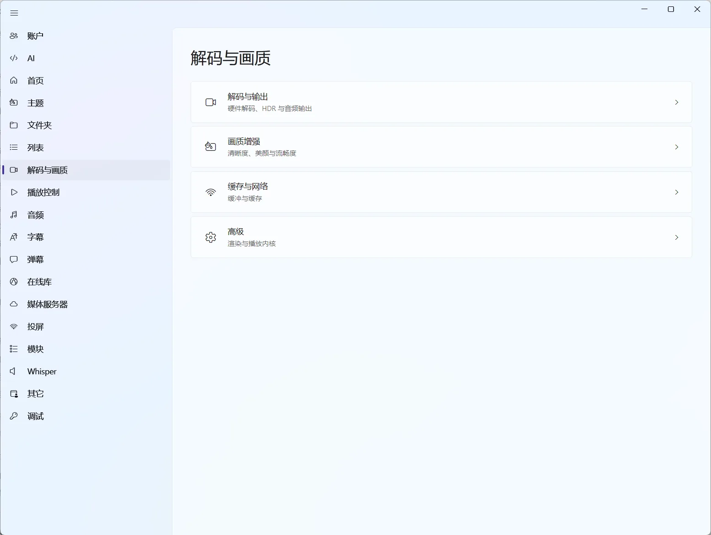

# 播放、解码与画质设置

这一页对应软件设置里的两个入口：`播放控制` 和 `解码与画质`。前者改变播放器怎么操作、怎么显示；后者改变视频由哪个内核、哪种渲染方式和哪种硬件解码路径处理，也集中了 HDR 输出、音频输出、画质增强和缓存与网络相关选项。

图：“解码与画质”分成解码与输出、画质增强、缓存与网络和高级四组，点进去才是具体选项。

第一次使用建议保持默认值。播放器能正常播放时，不要为了追求“更高性能”随意切换解码器、GPU 上下文或滤镜；这些选项更适合在遇到明确问题时逐项试验。

具体的观看操作见[播放器](/docs/player/)，黑屏、卡顿等现象见[播放失败、黑屏、卡顿](/docs/troubleshooting/playback)。

## Windows 默认组合

Windows 下的默认设置大致如下：

| 选项 | 默认值 | 它负责什么 |
| --- | --- | --- |
| 播放器解码内核 | MPV | 负责打开媒体并处理播放 |
| 渲染模式 | Native | 决定播放器使用哪种渲染路径 |
| 视频输出驱动 | `gpu-next` | 把处理后的画面输出到窗口 |
| GPU 上下文 | `d3d11` | 连接 Windows 图形设备 |
| 硬件解码 | `auto-copy` | 自动选择硬件解码，并采用兼容性更好的复制路径 |
| 音频输出驱动 | `wasapi` | 通过 Windows 音频接口输出声音 |
| M3U8 缓冲加速 | 开启 | 为在线流缓存分片，属于实验性功能 |

视频和音乐的默认播放模式都是“顺序播放”，音乐播放界面默认使用动画 MV。如果没有黑屏、卡顿或音画不同步，先保持这套组合即可。

## 先判断应该改哪一类

| 现象或需求 | 优先看的设置 |
| --- | --- |
| 想改手势、快进秒数、自动全屏 | 播放控制 |
| 想让控制面板更简洁，或隐藏缩略图 | 播放控制 |
| 想自动跳过片头片尾、预缓存下一集 | 播放控制 |
| 想让 HDR 片源自动切换 Windows HDR，或退出播放后还原 | 解码与画质 → 解码与输出 |
| 想把音频原样交给功放或电视，或调整声道输出 | 解码与画质 → 解码与输出 |
| 想调整缓冲上限、已播放数据保留量或磁盘缓存位置 | 解码与画质 → 缓存与网络 |
| 想给画面加色彩滤镜或播放美颜 | 解码与画质 → 画质增强 |
| 黑屏、花屏、GPU 占用异常 | 解码、硬件解码、视频输出驱动 |
| 画面卡顿、音画不同步 | 先关闭滤镜/着色器，再检查硬件解码 |
| 在线 M3U8 播放不稳定 | M3U8 缓冲加速 |
| 无声音或输出设备不对 | 音频输出驱动，以及[音频](/docs/player/audio)章节 |

不要同时修改渲染模式、GPU 上下文和硬件解码。一次只动一项，最容易找到真正有影响的设置。

## 播放控制

### 区域控制：手势、长按和触摸暂停

这些选项主要服务于触摸屏设备；普通鼠标用户不需要专门配置。

| 选项 | 作用 | 什么时候调整 |
| --- | --- | --- |
| 滑动手势 | 左右滑动屏幕调节播放进度 | 触摸操作与其他手势冲突时关闭 |
| 长按加速 | 长按屏幕右侧边缘约 100 像素进入加速播放 | 想快速略过片段时开启；可调加速倍率，范围约为 1.1～4.0 倍，默认 2 倍 |
| 触摸暂停 | 点击指定区域切换播放/暂停 | 容易误触时关闭，或改变暂停区域位置和大小 |

“暂停区域位置”可选上、下、左、右；“暂停区域大小”可选屏幕的 1/2、1/3、1/4、1/5。区域越大越容易点到，也越容易误触。

### 控制面板和进度条

| 选项 | 作用 | 使用建议 |
| --- | --- | --- |
| Acrylic 面板样式 | 给播放控制面板使用 Acrylic 背景 | 喜欢半透明效果时开启；它主要影响外观 |
| 进度条缩略图 | 鼠标移动到进度条时显示对应场景缩略图 | 可以按数据源单独开关；远程来源不需要缩略图时关闭，可减少网络请求 |
| 高能进度条 | 在进度条下显示视频精彩程度曲线 | 只有媒体分析出了高潮片段时才会出现曲线 |
| 前进与后退按钮 | 显示或隐藏进度跳跃按钮 | 习惯用键盘或手势时可以隐藏 |
| 上一个与下一个按钮 | 显示或隐藏播放列表中的上一项/下一项按钮 | 只播放单个文件时可以隐藏 |
| 媒体属性面板 | 显示左下角的媒体缩略图、名称和属性入口 | 想保持画面干净时关闭；需要查看媒体属性时打开 |
| 章节书签标记 | 在进度条刻度上标出章节书签位置 | 经常使用章节书签时建议保留 |

缩略图默认会根据来源类型和连接地址智能判断：本地文件通常开启，网盘/对象存储通常关闭；内网 IP 的媒体服务器通常开启，外网域名通常关闭。你可以在“进度条缩略图”中为每个来源覆盖这个默认值。

“面板样式”由软件统一管理，当前不提供单独的调整选项。播放面板的具体按钮位置和章节书签用法见[播放器界面](/docs/player/interface)与[播放列表与内容模块](/docs/player/content-modules)。

### 面板自动显示和隐藏

这里有两组容易混淆的选项：

- **播放面板自动显隐**：控制鼠标进入或离开面板区域时，顶部标题栏和底部控制栏是否立即出现或消失；顶部和底部可以分别设置。
- **自动隐藏播放面板**：鼠标停止移动一段时间后，自动隐藏底部控制面板。时间范围为 1～20 秒，默认约 5 秒。
- **自动隐藏鼠标**：播放时鼠标停止移动一段时间后隐藏光标，时间范围同样为 1～20 秒，默认约 5 秒。

如果你经常找不到控制栏，优先关闭“自动隐藏播放面板”；如果只是光标挡住字幕，保留面板自动隐藏、单独调整“自动隐藏鼠标”即可。

### 播放顺序、全屏和下一集

视频有一个“默认视频播放模式”。音乐这边分成两个设置，名字很像，作用不一样：

- **音乐播放界面**：选动画 MV 还是字幕 MV。改完后，下次打开音乐窗口生效。
- **音乐播放顺序**：新打开的音乐窗口一开始用哪种播放模式。播放器里临时切换只影响当前窗口，不会改回这里的默认值。

两种播放模式的可选项是一样的：

| 模式 | 行为 |
| --- | --- |
| 播放完停止 | 当前媒体结束后停住 |
| 单集循环 | 重复播放当前媒体 |
| 顺序播放 | 按播放列表顺序播放下一项 |
| 随机播放 | 从播放列表中随机选择下一项 |

动画 MV 和字幕 MV 的具体区别见[音乐播放器](/docs/player/music)。

此外还有几个影响观看节奏的开关：

- **自动全屏**：成功打开媒体后自动进入全屏。经常需要先检查片源或字幕时，可以关闭。
- **自动设置窗口大小**：播放后尝试把窗口调整到视频大小，便于无边框观看；不希望窗口被改变时关闭。
- **迷你进度条**：在播放界面底部显示一条很细的媒体进度条，适合隐藏完整控制栏后仍想快速判断进度的情况。
- **自动展示下一集按钮**：媒体剩余约 10 秒时，在右上角显示播放下一集按钮。
- **智能预缓存下一集**：在线剧集播放超过 60% 后，尝试提前缓存下一集媒体流。它可能增加网络流量和本地缓存，不稳定或流量有限时可以关闭。

### 片头片尾跳过

片头片尾跳过要分两件事看：区间从哪里来，以及播放时怎么跳。

区间可以有多个来源：

- **本地自动识别**：软件分析剧集的音频特征和画面，估计片头和片尾区间；
- **媒体服务器标记**：Emby、Jellyfin、Plex、飞牛影视、极影视等服务器自带片头片尾标记时，直接使用服务器给出的区间；
- **章节和弹幕**：片源自带章节，或弹幕里出现过“OP 结束”“跳过片头”这类提示时，也可以作为来源；
- **在线片头片尾库**：动漫优先尝试 AnimeSkip 一类的数据，The Intro Database 用于更广泛的媒体。两个服务都可以填写自己的 API 密钥，留空时使用软件内置密钥。

设置里能看到每一段区间来自哪个来源，也可以手动调整起止时间，或对某一段重新识别。

跳过方式有两种：

- **自动跳过**：播放到区间时直接跳过；
- **只显示跳过按钮**：画面角落出现一个跳过按钮，由你自己决定什么时候按。

如果只是偶尔想跳过片头，不必开启自动识别；先在[播放控制与快捷操作](/docs/player/controls)中手动设置区间更稳妥。

自动识别不是百分之百准确：片头较长、片尾有彩蛋、特别篇结构不同，或者网络串流无法完成本地音频分析时，都建议先播放确认，再手动修正时间点。这个功能只改变播放时的跳过行为，不会剪辑或改写原视频。

### 音量、快进和截图

- **播放器音量**是每次进入播放器时的初始音量，默认 100%。
- **播放器最大音量**决定音量滑块允许的上限，范围为 100%～200%，当前默认约 130%。超过 100% 属于放大，设备或音源不适合时可能出现失真。
- **左右方向键跳跃时间**决定左右方向键每次快进/快退多少秒，范围为 1～60 秒，默认 10 秒。
- **上下方向调整音量大小**决定上下方向键每次改变多少音量，范围为 1～10%，默认 5%。
- **截图**可以设置保存目录、文件名模板，并在输入时预览最终文件名。支持的占位符包括 `{剧名}`、`{视频文件名}`、`{季}`、`{集}`、`{季集}`、`{影片时间}`、`{系统日期}` 和 `{系统时间}`。
- **快捷键**可以为播放暂停、快进快退、音量、切集、章节、截图、旋转、AB 循环和退出等操作分别指定按键。完整的默认快捷键表见[播放控制与快捷操作](/docs/player/controls)。

### 播放器行为

| 选项 | 作用 |
| --- | --- |
| 失去焦点时 | 播放窗口失去焦点时暂停，或暂停并最小化；不适合被打断时建议开启 |
| 偏好音轨语言 | 自动选择音轨时优先匹配的语言 |
| 偏好字幕语言 | 自动选择字幕时优先匹配的语言 |

偏好语言只影响自动选择的结果，播放过程中仍然可以随时手动切换音轨和字幕轨道。

### 媒体徽章

“媒体徽章”控制播放界面右上角和媒体详情页是否显示 4K、HDR、Dolby Vision 这类规格标签，默认开启。关闭后徽章库仍然保留，重新打开就能继续用。

徽章的匹配依赖当前集的视频和音频元数据，媒体服务器返回的信息不完整时可能只显示一部分。导入徽章库、调整优先级和匹配预览见[媒体徽章](/docs/player/media-badges)。

## 解码与画质

设置里的“解码与画质”是一个统一页面，分成解码与输出、画质增强、缓存与网络、高级几组。下面的小节按同样的顺序展开。

### 播放器解码内核

当前使用 MPV 内核，它也是着色器、滤镜和 MPV 参数配置所在的环境。播放正常时不需要改动这一项。

### 渲染模式、视频输出驱动和 GPU 上下文

这三项都属于画面如何交给显卡/窗口的底层设置：

| 选项 | 可以怎么理解 | 建议 |
| --- | --- | --- |
| 渲染模式 | Native、OpenGL、Software 三种渲染路径；当前说明中的性能顺序为 Native、OpenGL、Software | 默认 Native；遇到特定显卡兼容问题时再尝试 OpenGL，Software 适合作为兼容性排查而不是日常首选 |
| 视频输出驱动 | 视频输出设施的接口，如 `gpu`、`gpu-next`、Windows 下的 `direct3d` 等 | 优先保持默认，黑屏或画面异常时一次切换一个选项 |
| GPU 上下文 | MPV 与 Windows 图形 API 之间的连接方式，默认 `d3d11` | 只有在显卡驱动、窗口渲染或 Vulkan/D3D 兼容性异常时调整 |

如果改完后画面直接黑屏，先恢复原来的视频输出驱动和 GPU 上下文，再尝试关闭硬件解码；不要一次把三项都换掉。

### 硬件解码

硬件解码会把部分视频解码工作交给 GPU，通常可以降低 CPU 占用，但不同显卡、驱动和编码格式的兼容性不同。

- `auto`、`auto-safe`、`auto-copy`：让 MPV 自动选择路径；日常优先保留默认的 `auto-copy`。
- `no`：关闭硬件解码，使用软件解码。它适合用来判断问题是不是由显卡硬件解码引起的，但 4K 或高码率视频可能增加 CPU 负担。
- `yes`：强制使用硬件解码；只有明确知道显卡支持当前格式时再尝试。
- `d3d11va`、`nvdec`、`cuda`、`vulkan` 等：指定某一种 Windows 硬件解码 API；带 `-copy` 的选项会采用复制路径，通常兼容性更好但可能牺牲一些效率。

出现花屏、绿屏、黑屏或字幕/滤镜异常时，先把硬件解码改为 `no` 测试一次。如果软件解码正常，再根据显卡和驱动情况尝试回到 `auto-copy`，而不是直接强制某个 API。

### 音频输出驱动

Windows 默认使用 `wasapi`。没有声音时，先检查系统当前输出设备、播放器音量和媒体音轨；只有确定是输出接口兼容问题时，才尝试其他驱动。音轨选择、均衡器和音频处理见[音频与均衡器](/docs/player/audio)。

### HDR 输出

HDR 片源可以选择三种处理方式：

- **直通**：把 HDR 信息原样交给显示设备，由电视或显示器自己处理；
- **自动切换 Windows HDR**：播放 HDR 片源时自动打开系统的 HDR 开关，退出播放后还原；
- **不接管**：完全交给系统当前的 HDR 状态。

自动切换还可以限制为“只在全屏时切换”，适合平时用 SDR 桌面、看片时才全屏的场景。切换过程中画面会短暂黑屏，属于系统切换 HDR 模式的正常现象。

### 音频透传与声道

| 选项 | 作用 |
| --- | --- |
| 按格式开启透传 | 把符合条件的音轨原样交给功放、回音壁或电视解码，例如 Dolby TrueHD、DTS-HD 这类格式 |
| 独占输出 | 播放时独占音频设备，避免其他程序抢占或改变采样率 |
| 多声道降混归一化 | 把多声道混成立体声时，避免对白突然变小或音量忽大忽小 |
| 声道布局 | 告诉播放器实际音箱摆位，多声道片源的下混和声道映射会更准确 |

设备不支持对应格式时，开启透传可能出现没有声音或只有杂音，先关闭确认。不确定设备能力时先保持默认，再逐项开启测试。

### 着色器和滤镜

这两个选项都在 MPV 内核下可用，但作用方式不同：

| 选项 | 选择数量 | 适合做什么 | 性能代价 |
| --- | --- | --- | --- |
| 着色器 | 可以选择多个组合 | 锐化、降噪、去块等画面处理 | 通常中等，组合越多越高 |
| 滤镜 | 当前选择一个 | zPlayer 内置滤镜主要用于补帧，也包含更重的画面处理 | 通常较高，可能造成卡顿和音画不同步 |

动漫、低清片源和老视频的推荐组合见[画质与滤镜](/docs/player/video-quality)。如果开启滤镜后出现卡顿，先关闭滤镜；如果仍然异常，再暂时关闭着色器和硬件解码，以便区分是处理链还是解码链的问题。

### 画质增强

“画质增强”把效果按用途分组，每组都能单独开启并选择档位：

| 分组 | 内容 |
| --- | --- |
| 清晰与放大 | 视频放大（AMD FSR、RAVU、FSRCNNX、NNEDI3）、细节锐化、动画增强（Anime4K） |
| 运动 | 运动补帧（MVTools、RIFE） |
| 人像 | 播放美颜：磨皮、瘦脸、五官调整、妆容和身材修饰 |
| 色彩 | 内置色彩滤镜与滤镜强度，可一键恢复原色 |
| RTX 视频增强 | RTX 视频超分与超分倍数、RTX 视频 HDR |

这些效果都实时作用在画面上，会增加 GPU 负担；同时开得越多，卡顿和音画不同步的风险越高。RTX 视频增强需要 NVIDIA RTX 显卡，并要求播放器使用 mpv 引擎的 Native（D3D11）渲染模式，显卡驱动内还要开启 Super Resolution。具体档位怎么选见[画质与滤镜](/docs/player/video-quality)。

### 自定义 libmpv

普通用户不需要改这个选项。它允许 MPV 使用你指定的 libmpv 动态库，也可以通过页面提供的下载功能获取可用版本。手动选择时按照页面提示选择兼容的 `libmpv-2.dll`；如果自定义库加载失败，关闭“自定义 libmpv”即可回到软件默认库。

### 缓存与网络

| 选项 | 作用 | 调整建议 |
| --- | --- | --- |
| 缓冲上限 | 播放器最多占用的解复用缓存 | 默认约 1024 MiB；网络不稳、频繁缓冲时可以调大 |
| 已播放数据保留量 | 回退或精确跳转时可以复用的已播放数据 | 默认约 512 MiB；内存紧张时调小，经常回退时调大 |
| 预读时长 | 提前读取多少时长的数据 | 调大能降低卡顿概率，也会增加磁盘和网络占用 |
| 磁盘缓存位置 | 缓存文件的保存目录 | 默认在软件缓存目录；系统盘紧张时可以改到其他磁盘 |
| 精确跳转 | 跳转时按音频帧对齐 | 定位更准，代价是稍慢；对音画同步要求高时可以开启 |
| M3U8 缓冲加速 | 多线程缓存在线分片，属于实验性功能 | 只在 M3U8 播放不稳定时测试开启或关闭 |

### M3U8 缓冲加速

这是一个实验性选项。开启后，软件会使用多线程把 M3U8 分片缓存到本地，适合网络抖动、分片加载慢的在线媒体；代价是会增加本地磁盘写入、缓存空间和网络并发。

如果普通本地视频出现问题，这个选项通常不是第一排查对象；如果只有 M3U8 播放异常，可以分别测试开启和关闭，并观察网络与磁盘占用。

### 其他 MPV 参数

“其他设置”允许手动添加 MPV 参数，例如 `vo=gpu`。这是给熟悉 MPV 的用户准备的高级入口：参数写错可能导致播放器行为异常，普通用户建议留空。需要查参数含义时，参考 [MPV 官方参数手册](https://mpv.io/manual/master/#options)，并且一次只添加一项。

## 改完之后怎么确认有效？

每次只改变一个选项，然后用同一部媒体重新打开测试：

1. 先关闭滤镜和着色器，确认基础播放是否正常。
2. 画面异常时，测试硬件解码 `auto-copy` 与 `no`。
3. 仍然黑屏，再单独测试视频输出驱动或 GPU 上下文。
4. 在线 M3U8 卡顿，再测试缓冲加速。
5. 记录最终能正常播放的组合，后面换片源时可以快速恢复。

如果播放器仍然打不开或问题只发生在某个来源，继续看[播放失败、黑屏、卡顿](/docs/troubleshooting/playback)和[文件服务](/docs/media/file-services)。
